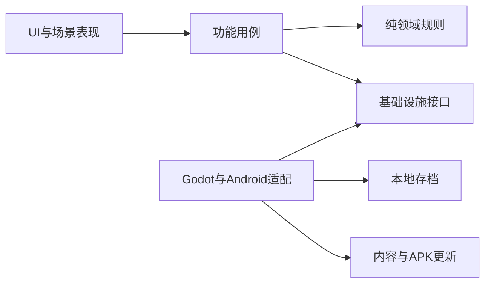

# 客户端目标架构

## 目标

让放置数值逻辑可独立测试、UI 可替换、存档可迁移，并让 AI 能在清晰边界内小步开发。当前是目标约束，不代表对应代码已经存在。

## 分层与依赖

- **领域层**：修为、境界、突破、收益公式和不变量；不依赖 Node、场景树、文件系统或系统时钟。
- **功能层**：编排一次修炼结算、突破尝试、加载/保存等用例；通过接口取得时间和持久化能力。
- **表现层**：场景、控件、动画、声音和输入；只显示状态并发出意图。
- **适配层**：Godot 文件、HTTP、PCK、Android 插件和系统 API；不得反向定义玩法规则。

依赖只朝领域方向流动。跨层传递明确类型的数据，不让 UI 节点或 Dictionary 成为隐式协议。

## 功能切片

功能按 `cultivation`、`realm`、`save`、`content_update` 等垂直切片组织。每个切片可以包含：

- `domain/`：实体、值对象、规则。
- `application/`：用例与端口。
- `presentation/`：场景和控制器。
- `tests/`：对应的单元或场景测试。

只有真实复用后才提取共享模块，禁止预先建立庞大的 `utils`。

## 全局服务边界

Autoload 仅用于启动顺序和跨场景基础能力，候选项为：

- Bootstrap：最早加载内容包并组装依赖。
- TimeService：提供统一时间与离线区间。
- SaveService：版本化读写和迁移。
- ConfigService：加载并验证数据定义。
- EventBus：仅承载确实跨功能、无直接所有者的少量事件。

业务规则不得堆入 Autoload，也不得从任意位置修改全局 Dictionary。

## 数据真相源

- 设计数值：版本化配置数据。
- 当前玩家状态：领域模型，经 SaveService 持久化。
- 界面显示：由用例输出派生，不反向写入核心状态。
- 内容版本：更新 manifest 与本地激活记录。

## 性能原则

放置游戏优先按时间区间做数学结算，不逐秒补跑离线逻辑。避免每帧轮询所有系统；状态变化使用信号或显式调度。正式素材进入后再依据设备数据设定纹理、音频和内存预算。
