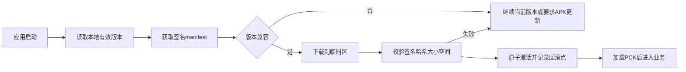

# Android 两层更新设计

## 边界

第一层更新程序包内的配置、文本、图片、音频；第二层更新 APK。玩法配置的发布走 ADR-0006 的后台和接口，不走这条 APK 渠道。当前 APK 热更已用公开 GitHub Releases 和 jsDelivr 在跑。

日常内容更新不应把任意未审核脚本当作资源下发。涉及原生插件、引擎、权限或核心逻辑兼容性时发布新 APK。

## 内容更新

Godot 4.7 可通过 `ProjectSettings.load_resource_pack()` 在运行时加载 PCK/ZIP。内容包必须在业务场景预加载前由 Bootstrap 激活，加载顺序和覆盖关系显式版本化。

manifest 至少包含：

- manifest/schema 版本。
- 应用版本与最低兼容应用版本。
- 内容版本、发布时间和回滚版本。
- 每个文件的 URL、字节大小、SHA-256、加载顺序和是否必需。
- manifest 签名与密钥标识。

客户端只内置公钥，私钥仅存在于离线或受控发布环境。更新失败继续使用上一有效内容，不能损坏存档。

## APK 更新

- 使用固定应用 ID 和同一发布签名，否则 Android 无法覆盖安装并保留应用数据。
- 客户端下载完整 APK，校验 manifest、SHA-256、大小和签名预期后，再调用 Android 插件。
- 是否有更新以 `versionCode` 为准：只涨版本名、不涨 `versionCode` 时，ColorOS 安装页会显示当前已装版本并提示“打开”，不会覆盖。
- 安装优先把 APK 字节写入系统 `PackageInstaller` 会话，再弹出确认页。不要把 FileProvider URI 当作 ColorOS 上的主路径：安装器读不到 URI 时会显示手机上已装版本（例如「已安装更高版本 0.1.5」）。
- FileProvider 只作会话失败后的底线：使用独立 authority、ClipData、`<queries>`，并把读权限授给已知系统安装器。
- 打开安装页前必须用 `PackageManager.getPackageArchiveInfo` 再读一遍下载文件的 `versionCode`，低于或等于已装值则拒绝打开系统页。
- 自定义 Gradle 构建加入 `REQUEST_INSTALL_PACKAGES`。
- 用户需要为当前应用允许“安装未知应用”，且每次覆盖安装由 Android 系统界面确认。
- 客户端不能静默安装，也不能绕过系统安全提示。

以后若进入 Google Play 等商店，应重新评估相关权限和商店政策；当前直装分发结论不能直接沿用到 iOS。

## 托管建议

APK 热更使用公开仓库 `micjason/xiuxian-releases`：

- 清单和签名放在 `main` 分支，客户端从 jsDelivr 读取。
- APK 放在 GitHub Releases，清单里的 `apk_url` 使用 Releases Assets API。
- 客户端请求必须带 `User-Agent`；下载 APK 时还要带 `Accept: application/octet-stream`。

`github.com` 网页下载和 `raw.githubusercontent.com` 在目标地区经常超时，不能作为客户端默认地址。正式运营前应再评估对象存储和 CDN。

## 回滚与兼容

- 新内容只依赖已声明的最低应用版本。
- 激活前保留上一 manifest 与包集合。
- 启动健康检查失败时标记新版本失败，并恢复上一内容版本。
- APK 降级通常受 Android 与存档兼容限制，不作为默认回滚手段；优先发布更高版本修复包。
