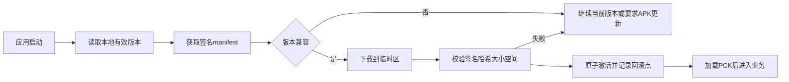

# Android 两层更新设计

## 边界

第一层更新配置、文本、图片、音频等内容；第二层更新 APK 程序。首期只预留接口，不实现服务、不购买服务器、不自动发布。

日常内容更新不应把任意未审核脚本当作资源下发。涉及原生插件、引擎、权限或核心逻辑兼容性时发布新 APK。

## 内容更新

Godot 4.7 可通过 `ProjectSettings.load_resource_pack()` 在运行时加载 PCK/ZIP。内容包必须在业务场景预加载前由 Bootstrap 激活，加载顺序和覆盖关系显式版本化。

manifest 至少包含：

- manifest/schema 版本。
- 应用版本与最低兼容应用版本。
- 内容版本、发布时间和回滚版本。
- 每个文件的 URL、字节大小、SHA-256、加载顺序和是否必需。
- manifest 签名与密钥标识。

客户端只内置公钥，私钥仅存在于离线或受控发布环境。更新失败继续使用上一有效内容，不能损坏存档。

## APK 更新

- 使用固定应用 ID 和同一发布签名，否则 Android 无法覆盖安装并保留应用数据。
- 客户端下载完整 APK，校验 manifest、SHA-256、大小和签名预期后，再调用 Android 插件。
- 自定义 Gradle 构建加入 `REQUEST_INSTALL_PACKAGES`，通过 FileProvider 向系统安装器提供 APK。
- 用户需要为当前应用允许“安装未知应用”，且每次覆盖安装由 Android 系统界面确认。
- 客户端不能静默安装，也不能绕过系统安全提示。

以后若进入 Google Play 等商店，应重新评估相关权限和商店政策；当前直装分发结论不能直接沿用到 iOS。

## 托管建议

早期只需要 HTTPS 对象存储加 CDN，不需要常驻业务服务器。建议区分不可变版本目录和一个小型渠道 manifest；切换 manifest 是发布动作，必须人工确认。

## 回滚与兼容

- 新内容只依赖已声明的最低应用版本。
- 激活前保留上一 manifest 与包集合。
- 启动健康检查失败时标记新版本失败，并恢复上一内容版本。
- APK 降级通常受 Android 与存档兼容限制，不作为默认回滚手段；优先发布更高版本修复包。
